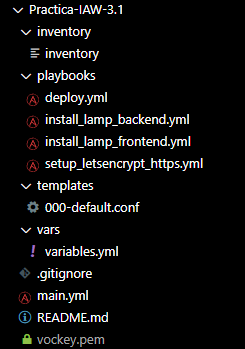
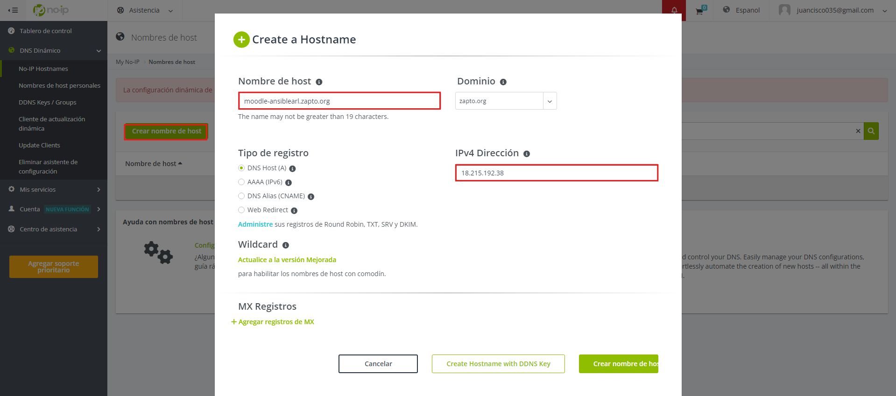

# Practica-IAW-3.1- Implantación de Moodle en Amazon Web Services (AWS) mediante Ansible

## Pasos previos a la instalación

**para la instalación vamos a tener que crear la siguiente estructura de directorios y archivos:**



**Una vez creados los archivos y directorios, procedemos a la instalación de las herramientas.**

## Implantación de Moodle en Amazon Web Services (AWS) mediante Ansible

## 1. Creamos un nombre de dominio para nuestro servidor con la web `no-ip`

### Paso 1. Crear el nombre del dominio 

Para crear el nombre de dominio en la página, tenemos que registrarnos y dirigirnos al sitio que muestra la captura y darle a **crear nombre de host**.



Una vez dado al recuadro de crear el nombre, nos sale un asistente para poner el nombre de host que queramos, el dominio que queremos que lleve, la dirección ip de la máquina o pc que queremos que tenga ese nombre de host y el tipo de registro que queremos que lleve, en nuestro caso es el **DNS Host A**

Hecho esto ya podemos automatizar la Implantación de Moodle en Amazon Web Services (AWS) mediante Ansible

## 1.1 Infraestructura necesaria

La infraestructura necesaria está compuesta de tres máquinas virtuales, un nodo de control para ejecutar los playbooks de ansible al resto de máquinas, un frontal donde se desplegará moodle (Frontend) y un backend donde tendremos la base de datos para moodle y el usuario (Back-End).

* Nodo de control.
* Frontal con el moodle desplegado.
* Servidor de Base de Datos MySQL. (Backend)

## 1.2 Aspectos importantes a tener en cuenta

Para que el nodo de control pueda ver las otras máquinas sin problemas, hay que crear una carpeta llamada `inventory` y dentro de ella un archivo llamado `inventory` con el siguiente contenido:

```yaml
[frontend]
18.215.192.38

[backend]
50.17.188.169

[all:vars]
ansible_user=ubuntu
ansible_ssh_private_key_file=/home/ubuntu/Practica-IAW-3.1/vockey.pem
ansible_ssh_common_args='-o StrictHostKeyChecking=accept-new'
```

> [!IMPORTANT]  
> `[frontend]:` Especifica el grupo de hosts que son parte del front-end de la infraestructura. Aquí, 18.215.192.38 es la IP del servidor frontend.  
> `[backend]:` Especifica el grupo de hosts que son parte del back-end de la infraestructura. Aquí, 50.17.188.169 es la IP del servidor backend.  
> `[all:vars]:` Define variables globales que se aplican a todos los hosts.  
> `ansible_user=ubuntu:` El nombre de usuario que se usará para conectarse a los hosts.  
> `ansible_ssh_private_key_file=/home/ubuntu/Practica-IAW-3.1/vockey.pem:` Ruta al archivo de clave privada SSH para autenticarse en los hosts.  
> `ansible_ssh_common_args='-o StrictHostKeyChecking=accept-new':` Argumentos adicionales de SSH, en este caso, para aceptar automáticamente nuevas claves de host sin preguntar.

También es importante darle los permisos necesarios a la clave `vockey.pem` para que pueda leer el archivo. Eso se puede hacer mediante chmod de la siguiente manera:

```bash
sudo chmod 400 vockey.pem
```

## 2. Creación del archivo `install_lamp_frontend` para la instalación de apache en el frontend.

### Paso 1. Actualizamos los repositorios

```yaml
---
- name: Playbook para instalar la pila LAMP en el FrontEnd
  hosts: frontend
  become: yes

  tasks:

    - name: Actualizar los repositorios
      apt:
        update_cache: yes
```

### Paso 2. Instalamos el servidor web Apache

```yaml
    - name: Instalar el servidor web Apache
      apt:
        name: apache2
        state: present
```

### Paso 3. Instalamos PHP y los módulos necesarios

```yaml
    - name: Instalar PHP y los módulos necesarios
      apt: 
        name:
         - php
         - php-mysql
         - libapache2-mod-php
         - php-bcmath
         - php-curl
         - php-gd
         - php-imagick
         - php-intl
         - php-memcached
         - php-mbstring
         - php-dom
         - php-zip
         - php-cli
         - php-xml
         - php-soap
       state: present
```

### Paso 4. Modificamos la configuración de PHP

```yaml
- name: Modificamos el valor max_input_vars de PHP
  replace: 
    path: /etc/php/8.3/apache2/php.ini
    regexp: ;max_input_vars = 1000
    replace: max_input_vars = 5000

- name: Modificamos el valor de memory_limit de PHP
  replace: 
    path: /etc/php/8.3/apache2/php.ini
    regexp: memory_limit = 128M
    replace: memory_limit = 256M

- name: Modificamos el valor de post_max_size de PHP
  replace: 
    path: /etc/php/8.3/apache2/php.ini
    regexp: post_max_size = 8M
    replace: post_max_size = 128M

- name: Modificamos el valor de upload_max_filesize de PHP
  replace:
    path: /etc/php/8.3/apache2/php.ini
    regexp: upload_max_filesize = 2M
    replace: upload_max_filesize = 128M
```

### Paso 5. Configuramos Apache y creamos los directorios necesarios

```yaml
- name: Copiar el archivo de configuración de Apache
  copy:
    src: ../templates/000-default.conf
    dest: /etc/apache2/sites-available/
    mode: 0755

- name: Crear directorio /var/www/html/moodle
  file:
    path: /var/www/html/moodle
    state: directory
    owner: www-data
    group: www-data
    mode: '0755'

- name: Crear directorio /var/www/moodledata
  file:
    path: /var/www/moodledata
    state: directory
    owner: www-data
    group: www-data
    mode: '0755'
```

### Paso 6. Habilitamos el módulo rewrite de Apache y reiniciamos Apache

```yaml
- name: Habilitar el módulo rewrite de Apache
  apache2_module:
    name: rewrite
    state: present

- name: Reiniciar el servidor web Apache
  service:
    name: apache2
    state: restarted
```

## 2. Creación del archivo `install_lamp_backend` para la instalación de mysql y creacion de la base de datos y el usuario en el backend

### Paso 1. Incluimos el archivo de variables

```yaml
---
- name: Playbook para instalar la pila LAMP en el Backend
  hosts: backend
  become: yes

  vars_files:
    - ../vars/variables.yml
```


### Paso 2. Actualizamos los repositorios

```yaml
tasks:

    - name: Actualizar los repositorios
      apt:
        update_cache: yes
```

### Paso 3. Instalamos el sistema gestor de bases de datos MySQL

```yaml
- name: Instalar el sistema gestor de bases de datos MySQL
      apt:
        name: mysql-server
        state: present
```

### Paso 4. Instalamos el modulo de pymysql

```yaml
- name: Instalamos el módulo de pymysql
      apt:
        name: python3-pymysql
        state: present
```

### Paso 5. Creamos la base de datos para moodle

```yaml
- name: Crear la base de datos para moodle
  mysql_db:
    name: "{{ moodle.db_name }}"
    encoding: utf8mb4
    collation: utf8mb4_unicode_ci
    state: present
    login_unix_socket: /var/run/mysqld/mysqld.sock
```

### Paso 6. Borramos el usuario para la base de datos de moodle si existe

```yaml
- name: Borra el usuario si existe
      mysql_user:
        name: "{{ moodle.db_user }}"
        host: "{{ moodle.ip_cliente_mysql }}"
        state: absent
        login_unix_socket: /var/run/mysqld/mysqld.sock
```

### Paso 7. Creamos el usuario para la base de datos de moodle

```yaml
   - name: Crear el usuario para la base de datos de moodle
      mysql_user:
        name: "{{ moodle.db_user }}"
        host: "{{ moodle.ip_cliente_mysql }}"
        password: "{{ moodle.db_password }}"
        priv: "{{ moodle.db_name }}.*:ALL"
        state: present
        login_unix_socket: /var/run/mysqld/mysqld.sock
```
